<!-- ╔══════════════════════════════════════════════════════════════════════════╗ -->
<!-- ║                                                                          ║ -->
<!-- ║   ██████╗  ██████╗ ██╗  ██╗ █████╗ ███╗   ██╗                           ║ -->
<!-- ║   ██╔══██╗██╔═══██╗██║  ██║██╔══██╗████╗  ██║                           ║ -->
<!-- ║   ██████╔╝██║   ██║███████║███████║██╔██╗ ██║                           ║ -->
<!-- ║   ██╔══██╗██║   ██║██╔══██║██╔══██║██║╚██╗██║                           ║ -->
<!-- ║   ██║  ██║╚██████╔╝██║  ██║██║  ██║██║ ╚████║                           ║ -->
<!-- ║   ╚═╝  ╚═╝ ╚═════╝ ╚═╝  ╚═╝╚═╝  ╚═╝╚═╝  ╚═══╝                       ║ -->
<!-- ║                                                                          ║ -->
<!-- ╚══════════════════════════════════════════════════════════════════════════╝ -->

<div align="center">

```
 ██████╗  ██████╗ ██╗  ██╗ █████╗ ███╗   ██╗     ██████╗██╗  ██╗ █████╗ ███╗   ██╗██████╗     ███╗   ███╗
 ██╔══██╗██╔═══██╗██║  ██║██╔══██╗████╗  ██║    ██╔════╝██║  ██║██╔══██╗████╗  ██║██╔══██╗    ████╗ ████║
 ██████╔╝██║   ██║███████║███████║██╔██╗ ██║    ██║     ███████║███████║██╔██╗ ██║██║  ██║    ██╔████╔██║
 ██╔══██╗██║   ██║██╔══██║██╔══██║██║╚██╗██║    ██║     ██╔══██║██╔══██║██║╚██╗██║██║  ██║    ██║╚██╔╝██║
 ██║  ██║╚██████╔╝██║  ██║██║  ██║██║ ╚████║    ╚██████╗██║  ██║██║  ██║██║ ╚████║██████╔╝    ██║ ╚═╝ ██║
 ╚═╝  ╚═╝ ╚═════╝ ╚═╝  ╚═╝╚═╝  ╚═╝╚═╝  ╚═══╝     ╚═════╝╚═╝  ╚═╝╚═╝  ╚═╝╚═╝  ╚═══╝╚═════╝     ╚═╝     ╚═╝
```

### `> Web 2 Developer | AIML Practitioner & Researcher`

</div>

<p align="center">
  
</p>

<p align="center">
  
   
  
  
  
</p>

---

<!-- ═══════════════════════════════════════════════════════════════════ -->
<!--                        EXPERIENCE                                  -->
<!-- ═══════════════════════════════════════════════════════════════════ -->

<p align="center">
  
</p>

<div align="center">

| Role |  Organization | Duration | Status |
|:--------|:----------------|:------------|:----------|
| **Research Intern** | NITK Surathkal | July — September 2026 |  |
| **Software Developer Intern** | YathiRai | September 2026 — Present |  |
| **Software Product Design Intern** | G-System | October 2026 — Present |  |
| **Software Developer Intern** | HashVault | November 2026 — Present |  |

</div>

---

<!-- ═══════════════════════════════════════════════════════════════════ -->
<!--                        TECH STACK                                  -->
<!-- ═══════════════════════════════════════════════════════════════════ -->

<p align="center">
  
</p>

<div align="center">

**`⌁ Frameworks & APIs`**  
[](https://skillicons.dev)  


**`⌁ Databases`**  
[](https://skillicons.dev)

**`⌁ DevOps & Cloud`**  
[](https://skillicons.dev)

**`⌁ AI / ML`**  
[](https://skillicons.dev)  


</div>

---

<!-- ═══════════════════════════════════════════════════════════════════ -->
<!--                     RESEARCH & DEVELOPMENT                         -->
<!-- ═══════════════════════════════════════════════════════════════════ -->


---

<!-- ═══════════════════════════════════════════════════════════════════ -->
<!--                        GITHUB ANALYTICS                             -->
<!-- ═══════════════════════════════════════════════════════════════════ -->

<p align="center">
  
</p>

 

  <p align="center">
    <a href="https://github.com/anuraghazra/github-readme-stats">
      
    </a>
    <a href="https://github.com/anuraghazra/github-readme-stats">
      
    </a>
  </p>

  <p align="center">
    <a href="https://github.com/denvercoder1/github-readme-streak-stats">
      
    </a>
  </p>


---

<!-- ═══════════════════════════════════════════════════════════════════ -->
<!--                        CONTRIBUTION SNAKE                           -->
<!-- ═══════════════════════════════════════════════════════════════════ -->

<p align="center">
  
</p>

<p align="center">
  
</p>

---

<!-- ═══════════════════════════════════════════════════════════════════ -->
<!--                        PINNED PROJECTS                              -->
<!-- ═══════════════════════════════════════════════════════════════════ -->

<p align="center">
  
</p>

<div align="center">

### Heapify
**Multi-agent NBFC compliance decisioning platform for RBI & DPDP regulations**


> Automates regulatory compliance checks using AI-driven decision pipelines with cryptographic audit trails.

### Drifting Oracle
**Enterprise credit risk monitoring and LLM governance platform**


> Detects data drift in real-time using PSI and SHAP variance to ensure financial model stability.

### Lorem Epsum
**Real-time IoT and AI vaccine cold chain surveillance system**


> Prevents vaccine degradation using sensor pipelines, AI compliance reports, and live threshold alerts.

</div>

---

<!-- ═══════════════════════════════════════════════════════════════════ -->
<!--                        ACHIEVEMENTS                                 -->
<!-- ═══════════════════════════════════════════════════════════════════ -->

<p align="center">
  
</p>


<table align="center" width="100%">
  <tr>
    <td width="50%" valign="top">
      <h3 align="center">🏆 2026 Achievements</h3>
      <table align="center" width="100%">
        <thead>
          <tr>
            <th align="center">Event</th>
            <th align="center">Result</th>
          </tr>
        </thead>
        <tbody>
          <tr>
            <td align="center">Nokia Shark Tank</td>
            <td align="center"></td>
          </tr>
          <tr>
            <td align="center">SIH '26 (Smart India Hackathon)</td>
            <td align="center"></td>
          </tr>
          <tr>
            <td align="center">Hacktoberfest (MLH & Gemma)</td>
            <td align="center"></td>
          </tr>
          <tr>
            <td align="center">Leap Hackathon (Govt. of Karnataka)</td>
            <td align="center"></td>
          </tr>
          <tr>
            <td align="center">Innovex Hackathon</td>
            <td align="center"></td>
          </tr>
          <tr>
            <td align="center">Innovatex BCU Hackathon</td>
            <td align="center"></td>
          </tr>
          <tr>
            <td align="center">Agentathon</td>
            <td align="center"></td>
          </tr>
          <tr>
            <td align="center">Altaria National Hackathon</td>
            <td align="center"></td>
          </tr>
          <tr>
            <td align="center">NMIT HACKS</td>
            <td align="center"></td>
          </tr>
          <tr>
            <td align="center">Hack A War</td>
            <td align="center"></td>
          </tr>
        </tbody>
      </table>
    </td>
    <td width="50%" valign="top">
      <h3 align="center">🏆 2025 Achievements</h3>
      <table align="center" width="100%">
        <thead>
          <tr>
            <th align="center">Event</th>
            <th align="center">Result</th>
          </tr>
        </thead>
        <tbody>
          <tr>
            <td align="center">Smart India Hackathon</td>
            <td align="center"></td>
          </tr>
          <tr>
            <td align="center">UIP Hackathon</td>
            <td align="center"></td>
          </tr>
          <tr>
            <td align="center">Shark Tank (College)</td>
            <td align="center"></td>
          </tr>
          <tr>
            <td align="center">UIUX Solo Competition</td>
            <td align="center"></td>
          </tr>
          <tr>
            <td align="center">Limitless Mind Hackathon</td>
            <td align="center"></td>
          </tr>
        </tbody>
      </table>
    </td>
  </tr>
</table>

---

<!-- ═══════════════════════════════════════════════════════════════════ -->
<!--                     HEAPIFY GLOBAL COMMUNITY                        -->
<!-- ═══════════════════════════════════════════════════════════════════ -->

<p align="center">
  
</p>

<div align="center">


<p>
  
  
  
  
  
</p>

</div>

---

<!-- ═══════════════════════════════════════════════════════════════════ -->
<!--                        CONNECT                                      -->
<!-- ═══════════════════════════════════════════════════════════════════ -->

<p align="center">
  
</p>

<div align="center">

```
rohan@dev:~$ cat contact_info.json
```

</div>

<p align="center">
  <a href="https://www.linkedin.com/in/rohan-chand-m-ab184832a/"></a>
  <a href="mailto:rohan8899chand@gmail.com"></a>
  <a href="https://github.com/rohan-chand-m-01"></a>
</p>


<p align="center">
  <i>"Engineering intelligence, one system at a time."</i>
</p>

<p align="center">
  
</p>

<p align="center">
  
</p>
