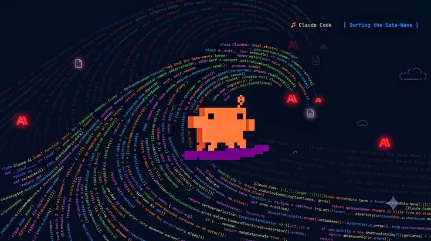

  

  <code>┌─[ rohan@github ]─[ ~/profile ]</code> 
  <code>└──╼ $ whoami</code>

<h1 align="center">Rohan Chand M</h1>

<strong>Web 2 Developer · AIML Practitioner &amp; Researcher</strong>

  
  
  

  

## `01 / EXPERIENCE`

| Role | Organization | Timeline |
|---|---|---|
| Research Intern | NITK Surathkal | July – September 2026 |
| Software Developer Intern | YathiRai | September 2026 – Present |
| Software Product Design Intern | G-System | October 2026 – Present |
| Software Developer Intern | Hashvalut | November 2026 – Present |

## `02 / COMMUNITY`

### Founder — Heapify Global Community

- Leading **30+ core members** and a community of **1,000+ members**.
- Organized **20+ collaborations**, including with **MLH, Gemini, Gemma, and Kaggle**.
- Built college partnerships spanning **5+ colleges** and **3+ Indian states**.

## `03 / RESEARCH & DEVELOPMENT`

- **Stable Diffusion models and machine unlearning**
- **Audio forensics**
- **Fintech compliance, KYC, and AML**

## `04 / TECH STACK`

**Backend & Web** 

**Databases** 

**DevOps & Cloud** 

**AI / ML** 

**Python libraries for AI, computer vision, and machine learning**

## `05 / PINNED PROJECTS`

### Heapify
**Multi-agent NBFC compliance decisioning platform for RBI & DPDP regulations**

> Automates regulatory compliance checks using AI-driven decision pipelines with cryptographic audit trails.

### Drifting Oracle
**Enterprise credit risk monitoring and LLM governance platform**

> Detects data drift in real-time using PSI and SHAP variance to ensure financial model stability.

### Lorem Epsum
**Real-time IoT and AI vaccine cold chain surveillance system**

> Prevents vaccine degradation using sensor pipelines, AI compliance reports, and live threshold alerts.

## `06 / ACHIEVEMENTS`

  
  
  

### 2026 highlights

- **Nokia Shark Tank** — Semifinalist
- **Hacktoberfest** — 3× Winner (MLH and Gemma)
- **LEAP Hackathon** — Top 5, Government of Karnataka
- **Smart India Hackathon 2026** — Semifinalist

### Other results

- **Innovex Hackathon** — Winner
- **Innovatex BCU Hackathon** — Winner
- **Agentathon** — 1st Runner-Up
- **Altaria National Hackathon** — 2nd Runner-Up
- **NMIT HACKS** — Finalist
- **Hack A War** — Top 10
- **Smart India Hackathon 2025** — Semifinalist
- **UIP Hackathon** — Semifinalist
- **Shark Tank (College)** — 2nd Runner-Up
- **UIUX Solo Competition** — Runner-Up
- **Limitless Mind Hackathon** — Top 7

*The semifinalist and finalist summary counts the results listed here, including the existing profile achievements.*

## `07 / GITHUB ANALYTICS`

  

  
  

  

  

## `08 / CONTRIBUTION SNAKE`

  

## `09 / CONNECT`

  
  
  

<i>Engineering intelligence, one system at a time.</i>

  

  

